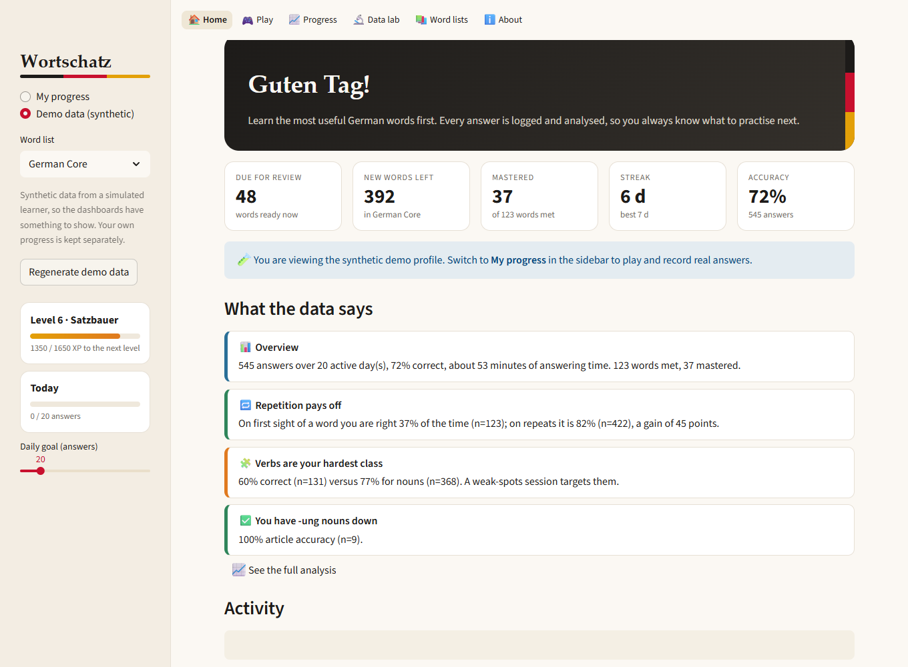
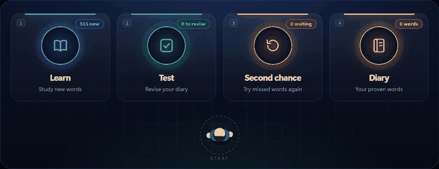
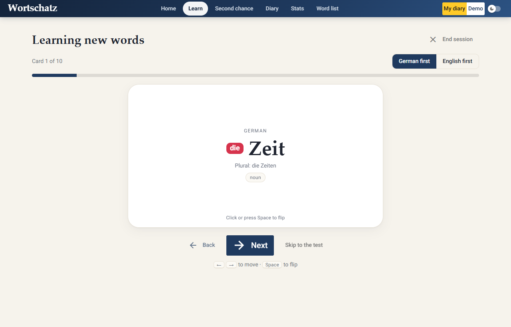
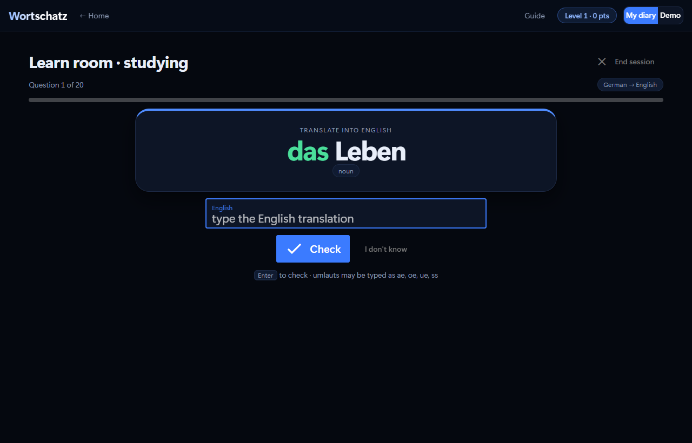
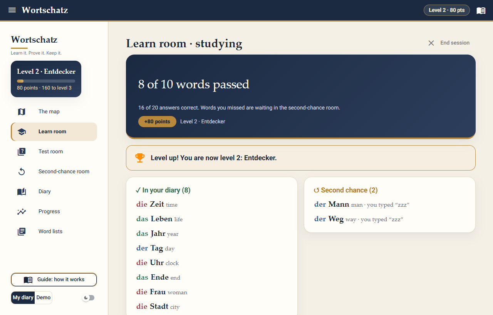
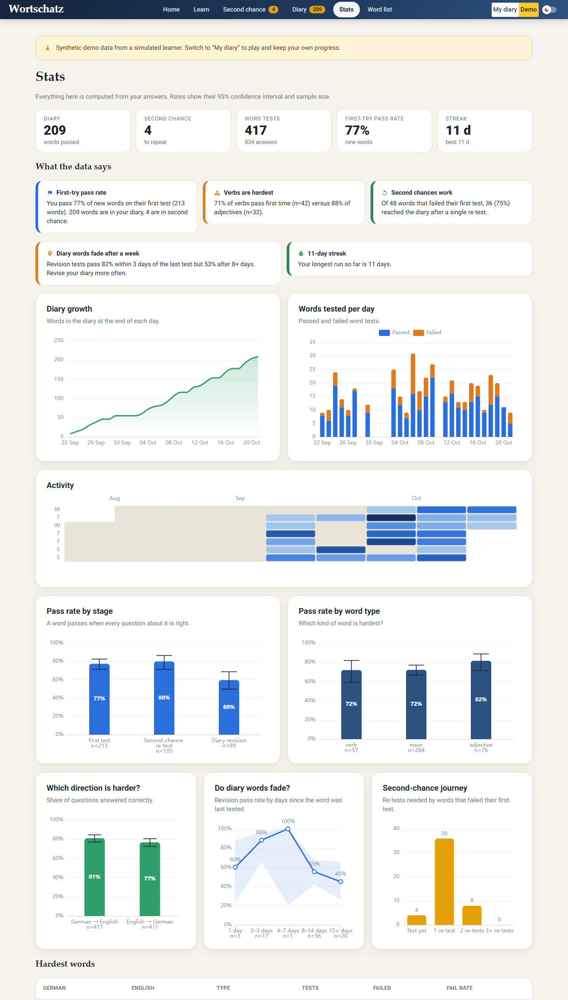
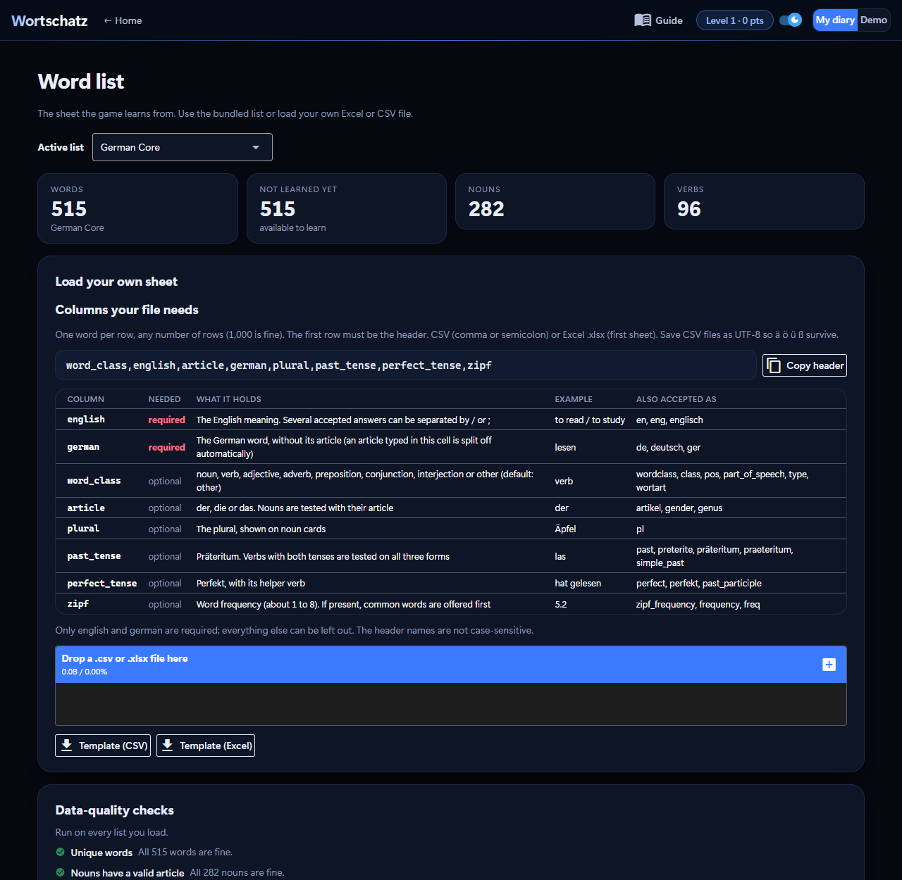

# Wortschatz: learn German words, pass the test, build your diary

A local vocabulary game with one idea: **a word only enters your diary after you have proven you know it.**
Load an Excel or CSV sheet of German words, pick nouns, verbs or adjectives and how many to learn today,
study the cards, take a typed test, and let the game sort every word for you:

```
                  pass the test                       revise the diary any time
 new word  ─────────────────────────►  MY DIARY  ◄─────────────────────────────┐
     │                                   │  ▲                                    │
     │ miss a word                       │  │ pass the re-test                   │
     ▼                                   │  │                                    │
 SECOND-CHANCE LIST  ◄───────────────────┘  │                                    │
     └──── study it again, take a re-test ──┘      a word you miss in a revision test goes back
```

The opening page is four big buttons, one per mode, in a black and deep-blue design. Click one (or press **1**–**4**) and a small top-view character
**runs to the button, jumps onto it, and the mode starts**. There is no sidebar. The **Guide** is one button away (it opens a pop-up, so it is out of the way until you want it).





| Mode | What you do there |
|---|---|
| **Learn** | Study new words as cards, then take the typed test. Passed words go into the diary. |
| **Test** | Revision: test yourself on the words in your diary. A word you miss goes back to second chance. |
| **Second chance** | Words you missed wait here. Study them again and pass a re-test to send them to the diary. |
| **Diary** | Your personal room: every word you have proven, searchable and exportable. |

Under the buttons are your level, today's points and your streak, and buttons for the **Guide**, **Progress** (the statistics), **Word lists** (add your own Excel or CSV) and **Reset progress**. The switch in the top bar toggles **dark and light** ([light version](docs/home_light.png)); your choice is remembered.
The character is plain canvas JavaScript ([`webapp/static/hero.js`](webapp/static/hero.js)); without it the buttons still work, and with *reduce motion* set in
your system the animation is skipped. [The Guide](docs/guide.png) · [phone width](docs/home_mobile.png)

| Study cards (click to flip) | Typed test |
|---|---|
|  |  |
| **Results: points and where each word went** | **Progress** |
|  |  |

More: [Learn](docs/learn.png) · [flipped card](docs/card_back.png) · [feedback after an answer](docs/feedback.png) · [Test](docs/test_room.png) ·
[second chance](docs/second_chance.png) · [diary](docs/diary.png)

## The rules

1. **Load a sheet.** An Excel or CSV file with the English and German words, plus (optionally) article, plural, past tense and perfect tense.
   A 515-word list is bundled.
2. **Learn.** Choose a word type (nouns, verbs, adjectives, ...) and how many words. Study them as flip cards: nouns show the
   article and plural, verbs show the infinitive with Präteritum and Perfekt. Cards can start with German or English.
3. **Test.** Every word is asked both ways, **German → English** and **English → German**, and you *type* the answer.
   Nouns need their article; verbs need the infinitive, Präteritum and Perfekt.
4. **Sort.** A word passes when *every* question about it was right.
   - passed → it goes into **My diary**
   - missed → it goes onto the **second-chance list**
5. **Second chance.** Study the missed words again and take a **re-test**. Pass it and the word moves into the diary; miss it and it stays.
6. **Revise.** Open the Test mode (revision) whenever you like and test yourself on diary words. A word you miss goes **back to the second-chance list**,
   so the diary only ever holds words you currently know.

In every mode you first **choose the word list** (or all your words), so you can work through one list at a time.

### Points and levels

Points reward proof, not effort: **+10** for passing a new word first time, **+6** for rescuing a word from the second-chance room,
**+4** for passing a diary revision, and **0** for a miss (never a penalty). Points are computed from the answer log, so they always match what
happened. Levels get further apart as you go: *Anfänger*, *Entdecker*, *Wortsammler*, *Sprachschüler*, *Wortschmied*, *Satzbauer*, *Redner*, *Kenner*, *Meister*, *Wortzauberer*.

Every move is saved the moment a word is finished, so closing the window never loses progress.

**Starting over.** *Reset progress* (on the opening page and in the Diary) wipes your diary, second-chance list, answer history and points, after a confirmation that offers a zip backup first. Your word lists are not touched. Your progress is stored in `user_data/` on your own computer and is **ignored by git**, so nothing of it ever reaches GitHub: someone who downloads the project always starts with an empty diary.

## Quick start

You need **Python 3.11 or newer**.

```bash
git clone -b vocab-game https://github.com/jkevinthomas4321/My_German_Vocab_Game.git
cd My_German_Vocab_Game
pip install -r requirements.txt
python main.py
```

A browser tab opens at `http://localhost:8080` (if another program uses that port, the game picks the next free one and prints the address). On Windows you can also double-click `run.bat`; on macOS and Linux run `./run.sh`.
Everything runs and stays on your own computer. Your diary is saved as plain CSV in `user_data/` (open it in Excel if you like).

Switch to **Demo** (top right) to explore the Stats page straight away: it shows a month of play by a *simulated* learner,
separate from your own diary.

## Your own words

Open **Word lists** (button under the main buttons). The page shows the **columns your file needs**, with a *Copy header* button, and templates to download. Drop in a `.csv` or `.xlsx` file (any number of rows) and the game cleans it, shows what it changed, and lets you save it as a list to learn from.



The header row to use:

```
word_class,english,article,german,plural,past_tense,perfect_tense,zipf
```

| Column | Required | Notes |
|---|---|---|
| `english`, `german` | yes | Several accepted English translations can be separated by `/` or `;` (`to do / make`). |
| `word_class` | no | noun, verb, adjective, ... (default *other*) |
| `article` | no | der / die / das. `der Tisch` in the German cell is split automatically. |
| `plural`, `past_tense`, `perfect_tense` | no | Shown on cards; verbs with both tenses are tested on all three forms. |
| `zipf` | no | Word frequency; if present, new words are offered most common first. |

Header spellings like *Englisch*, *Deutsch*, *Artikel*, *Wortart* work too, as do semicolon-separated CSVs from German Excel.
Download a template from the Word list page.

## How answers are checked

- **English:** case, spacing, a leading *to / the / a* and bracketed hints are ignored, and any translation listed in the sheet is accepted.
- **German:** must be spelled exactly, nouns with their article. Typing `ae oe ue ss` for `ä ö ü ß` is accepted, and there are ä ö ü ß buttons.
- A blank answer, a dash, or **I don't know** is wrong. A near miss shows "Almost", but is not credited.

## The Stats page

Everything on it is computed from one log of your answers (`attempts.csv`) with pandas, so the numbers can never disagree with what happened.
Rates carry a **95% Wilson confidence interval** and their sample size, because 100% over three tests is not the same evidence as over three hundred.

| Question | Answered by |
|---|---|
| How fast does my diary grow? | Daily diary size (+1 on entering, −1 when a word falls back or is removed) |
| Do I pass new words first time? | First-test pass rate, by word type and by direction |
| Which direction is harder? | German → English vs English → German accuracy and median answer time |
| Do second chances work? | Re-tests needed by words that failed their first test |
| Do I forget diary words? | Revision pass rate by days since the word was last tested |
| What are my hardest words? | Words that failed most often |
| When do I practise? | Calendar heat map, daily tests, streaks |

The page also writes plain-language findings, and each one stays silent when its sample is too small to say anything.

## Under the hood

```
main.py                 start the app (NiceGUI)
webapp/                 the interface: the opening page, flip cards, charts, dark theme
  static/hero.js          the character that runs to a button and jumps on it (canvas, no libraries)
wortschatz/             the game, with no UI code
  progress.py             THE RULES: where a word lives, in 6 transitions
  session.py              choosing words, study cards, the test engine
  answers.py              checking typed answers
  storage.py              progress.csv and attempts.csv (atomic writes)
  stats.py                the statistics
  points.py               points and levels, derived from the answer log
  wordlist.py             reading, cleaning and validating CSV / Excel sheets
  demo.py                 the simulated learner behind the Demo profile
data/wordlists/         the bundled word list
tools/                  how the bundled list is built and checked
tests/                  195 tests
```

The rules live in one small module ([`wortschatz/progress.py`](wortschatz/progress.py)) and are tested exhaustively:
all six transitions, the counters, and an invariant that **the saved diary equals what replaying the answer log under the rules produces**.
The interface is NiceGUI (a Python framework on Quasar/Vue), chosen over Streamlit for real control over the design: 3D flip cards, keyboard-driven tests,
custom components, an animated character, and a dark theme.

### The bundled word list

`data/wordlists/german_core.csv`: **515 common words** (282 nouns with article and plural, 96 verbs with Präteritum and Perfekt, 75 adjectives, plus
adverbs, prepositions, conjunctions and interjections), sorted by measured frequency. The translations, articles, plurals and verb forms were written
by hand (with Claude Code) in [`tools/seed_words.csv`](tools/seed_words.csv) and are checked by automated rules, which cannot prove a translation is *right*, so a quick
look against your textbook is worthwhile. Frequency comes from the [`wordfreq`](https://github.com/rspeer/wordfreq) package (data licensed CC BY-SA 4.0; keep
that attribution if you redistribute the CSV). To rebuild it: `pip install -r requirements-dev.txt && python tools/build_wordlist.py`.

## Tests

```bash
pip install -r requirements-dev.txt
python -m pytest
```

195 tests (about three minutes): the rules and every transition, answer checking, word selection, the test engine, saving and reloading, CSV/Excel cleaning,
every statistic against hand-computed numbers (and on empty data), the demo simulator, and **end-to-end tests where a simulated browser plays the real app**
(click a mode button, learn, miss a word, pass the re-test, fail a revision, earn points and a level, quit half way, switch word lists, verbs with three form boxes). Tests use a temporary data folder
and never touch your diary.

## Limitations

- A single-user, local app: no login and no hosting (your diary lives in files on your computer).
- Only `.xlsx` is supported for Excel (not legacy `.xls`).
- No audio and no example sentences.
- The demo data is simulated: it demonstrates the statistics and is not evidence about real learners.

## Credits

Built with Python, pandas, NumPy and [NiceGUI](https://nicegui.io). Designed and implemented with [Claude Code](https://claude.com/claude-code),
replacing an earlier Streamlit version of this project (still in this branch's history, and the original is on `master`).
