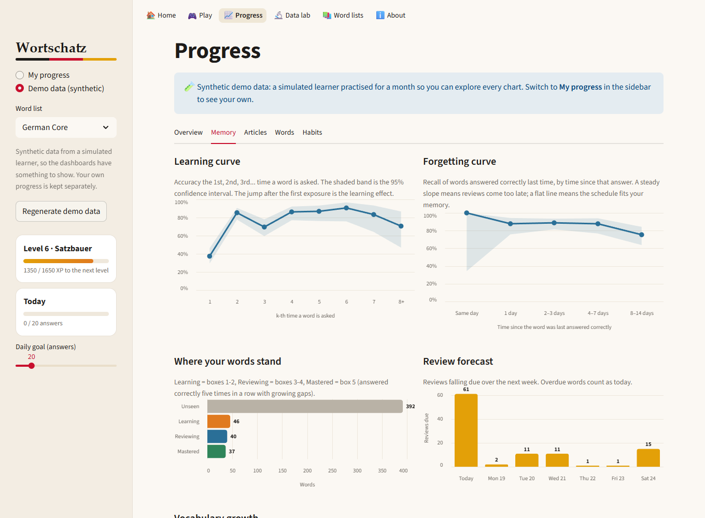
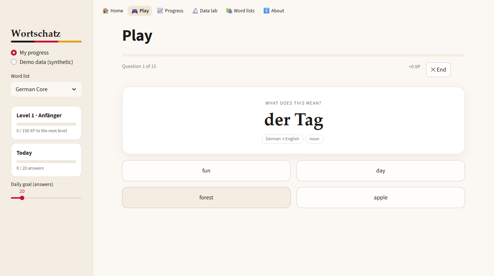
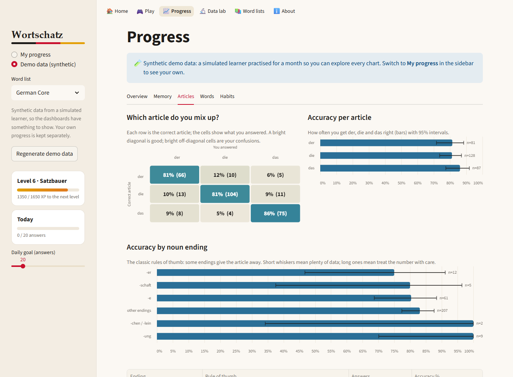

# Wortschatz: a German vocabulary trainer with a learning-analytics dashboard

Wortschatz (*word treasure*) is a Streamlit app for learning German vocabulary. You play short sessions of
different question types, every answer is logged, the next review is scheduled from that log, and a dashboard
analyses how you learn: memory curves, which articles you confuse, your hardest words, when you study best.

It runs **on your own computer**: your progress is saved as plain CSV files next to the code and never leaves
your machine. (That is also why there is no hosted version: a shared server would mix everyone's progress together.)

| Home | Progress: memory |
|---|---|
|  |  |
| **Play** | **Progress: articles** |
|  |  |

More: [feedback after an answer](docs/play_feedback.png) · [word analysis](docs/progress_words.png) · [dataset profile](docs/datalab.png)

## Quick start

You need **Python 3.11 or newer** (tested on 3.11 and 3.13).

1. **Download** the code: on GitHub choose *Code → Download ZIP* and unzip it, or
   ```bash
   git clone -b vocab-game https://github.com/jkevinthomas4321/My_German_Vocab_Game.git
   cd My_German_Vocab_Game
   ```
2. **Install and run**
   ```bash
   pip install -r requirements.txt
   streamlit run app.py
   ```
   or double-click `run.bat` (Windows) / run `./run.sh` (macOS, Linux), which do the same.
3. Your browser opens at `http://localhost:8501`. (If Streamlit asks for an e-mail address in the terminal on its first
   run, just press Enter.)

**No data yet?** Pick **Demo data (synthetic)** in the sidebar (or open `http://localhost:8501/?profile=demo`) to explore every
dashboard immediately. It is a month of practice produced by a simulated learner, clearly labelled as such, and
completely separate from your own progress (**My progress**).

## What you can do

| Page | |
|---|---|
| **Play** | Sessions of 5 to 30 questions in five modes: *Smart review* (due reviews first, then new words), *Article trainer*, *Type it*, *Verb forms*, *Weak spots*. One question at a time, instant feedback with a mini-lesson (plural, verb forms), XP, combos, levels and a session summary. |
| **Progress** | The analytics dashboard (see below). |
| **Data lab** | Exploratory analysis of the word list itself: composition, how well noun endings predict the article, frequency distribution, automated data-quality checks. |
| **Word lists** | Learn from your own **CSV or Excel** file. Only `english` and `german` columns are required. |
| **Home** | Today's plan, the most important findings, an activity calendar and badges. |

### Bring your own vocabulary (CSV or Excel)

Upload a `.csv` or `.xlsx` on the *Word lists* page (a template is provided). It is cleaned, a report shows exactly what was
changed, and it appears in the sidebar's *Word list* picker.

| Column | Required | Notes |
|---|---|---|
| `english`, `german` | yes | Header spellings such as *Englisch*, *Deutsch* also work. |
| `word_class` | no | noun, verb, adjective... (default *other*) |
| `article` | no | der / die / das. `der Tisch` in the German cell is split automatically. |
| `plural`, `past_tense`, `perfect_tense` | no | Enable plural and verb-form questions. |
| `zipf` | no | Word frequency; enables the frequency analysis. |

Semicolon-separated CSV from German Excel and Windows-1252 encoding are detected automatically; Excel sheets can be chosen.
Cleaning covers empty and incomplete rows, `-`/`n/a` placeholders, duplicates, Unicode normalisation and unusual articles.

## The analytics

All analytics are pure pandas/NumPy functions in [`wortschatz/analytics.py`](wortschatz/analytics.py) (no Streamlit), so they can be
reused in a notebook and are unit-tested against hand-computed values.

| Question | Method |
|---|---|
| Does repetition work? | **Learning curve**: accuracy on the 1st, 2nd, 3rd... time a word is asked, with 95% intervals. |
| Do I forget? | **Forgetting curve**: recall of words answered correctly last time, by days since that answer. Conditioning on a previous success separates *forgetting* from never having learned the word. |
| Which articles do I mix up? | **Confusion matrix** of correct vs. answered article, and accuracy per noun ending (-ung, -heit, -er ...). |
| Which words are hardest? | **Beta-prior smoothed error rate**: shrinks a word's error rate toward your overall rate, so one unlucky miss on a word asked twice does not outrank a word missed 6 times in 10. |
| Do common words stick faster? | **Spearman rank correlation** between measured word frequency and accuracy. |
| How fluent am I getting? | Median response time of correct answers over time; speed of right vs. wrong answers. |
| When do I study best? | Accuracy and volume by hour and weekday. |
| What is my workload? | Review forecast for the next 7 days; mastery funnel (unseen, learning, reviewing, mastered); vocabulary growth. |

Every rate is shown with its sample size and a **Wilson score interval**, because 100% over three answers is not the same evidence as
100% over three hundred. The *Findings* panel turns these into plain-language statements and stays silent when the sample is too small.

## How it works

```
word list (CSV / XLSX) --> wordlist.py  (read, clean, validate, report)
                               |
                               v
                       questions.py  (plan a session: due words, new words by frequency, question types)
                               |
                               v
               Play page --> grading.py --> events.py  --> user_data/<profile>/events.csv   (one row per answer)
                                                                  |
                          srs.py (Leitner boxes, replayed) <------+------> analytics.py / insights.py / gamification.py
```

- **One source of truth.** The event log. Scheduling state, XP, levels, badges, streaks and every chart are *derived* from it, so
  nothing can drift out of sync and there is no second file to corrupt.
- **Spaced repetition.** Leitner boxes: a correct answer moves a word up one box (longer wait), a wrong one drops it two. Box 5
  counts as mastered. The state is a pure function of the log, so it can be recomputed at any moment.
- **Frequency-first curriculum.** New words are introduced from most to least common (advancing through every word class in proportion),
  and fewer new words are added while many reviews are overdue.
- **Grading.** Case, spacing and `ae/oe/ue/ss` for umlauts are forgiven; spelling is not. A dash or empty answer is never correct. A
  wrong answer comes back once at the end as an *ungraded* retry, so it teaches without distorting the statistics.
- **The demo profile** is generated by [`wortschatz/simulate.py`](wortschatz/simulate.py): a learner with exponential forgetting,
  growing memory stability, prior knowledge of frequent words and log-normal response times, driven through the app's *real* planner,
  grader and scheduler.

```
app.py                  entry point (top navigation)
views/                  one file per page: home, play, progress, datalab, library, about
ui/                     theme, components, Altair chart builders, per-run context
wortschatz/             Streamlit-free core: wordlist, questions, grading, srs, events,
                        analytics, insights, gamification, simulate, german, config
data/wordlists/         german_core.csv (bundled word list)
tools/                  seed_words.csv + build_wordlist.py (how the bundled list is made)
tests/                  183 tests
user_data/              your progress (git-ignored, created on first run)
```

## The bundled data

`data/wordlists/german_core.csv` has **515 common words**: 282 nouns with article and plural, 96 verbs with Präteritum and Perfekt,
75 adjectives, plus adverbs, prepositions, conjunctions and interjections, sorted by **measured frequency**.

- The translations, articles, plurals and verb forms were written by hand in [`tools/seed_words.csv`](tools/seed_words.csv) (with Claude Code)
  and are checked by automated rules (valid articles, verb forms, no duplicates, ...) in `tools/build_wordlist.py` and by the 10 quality checks on the Data lab page. Automated rules cannot prove a translation is
  *right*, so a quick look against your textbook is worthwhile. Where an English word is ambiguous it is disambiguated in
  brackets, e.g. *to (a person or place)* for **zu**.
- The frequency column is the Zipf frequency from the [`wordfreq`](https://github.com/rspeer/wordfreq) package (7 = extremely common, 3 = rare).
  Its data is licensed CC BY-SA 4.0; please keep that attribution if you redistribute the CSV.
- Finding from the Data lab: guessing the article from a noun's ending is right for 62% of the nouns in this list, versus 41% for
  always guessing the most common article. The reliable endings (-ung, -heit/-keit, -schaft, -ion, -tät) have no exceptions here.
- To rebuild the list after editing the seed: `pip install -r requirements-dev.txt && python tools/build_wordlist.py`.

## Tests

```bash
pip install -r requirements-dev.txt
python -m pytest
```

183 tests (about 40 seconds): word-list reading and cleaning, grading (including regressions such as "a dash is never correct"), question
building, the scheduler, every analytics function against hand-computed numbers (and on empty data), the simulator, badges and insights,
structural checks that every chart layer has its encodings, and end-to-end tests that drive each Streamlit page headlessly with
`streamlit.testing.v1.AppTest` (playing whole sessions, retries, the demo profile, dashboards). Tests use a temporary data folder
and never touch your progress. The suite passes on Streamlit 1.46, 1.48 and 1.66 in clean environments.

## Limitations

- Single user, local files; the event log is appended to without file locking.
- Only `.xlsx` is supported for Excel (not legacy `.xls`).
- No audio and no example sentences; a word with several valid translations is asked with one of them.
- The demo data is simulated: it demonstrates the analysis, it is not evidence about real learners.
- The bundled list is a core vocabulary of 515 words; bring your own list for more.

## Credits

Built with Python, pandas, NumPy, Altair and Streamlit. Designed and implemented with [Claude Code](https://claude.com/claude-code),
building on an earlier, simpler version of this project (still available on the `master` branch).
