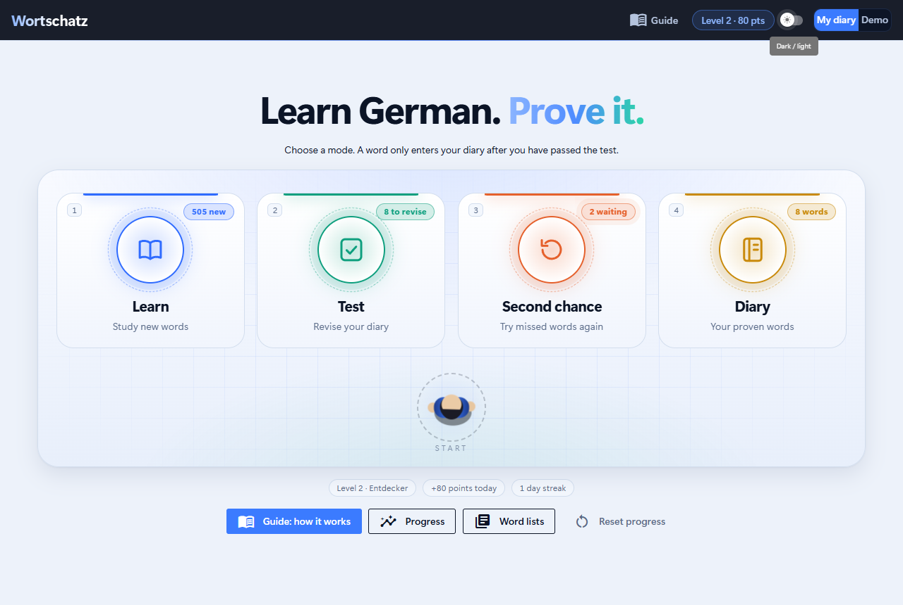
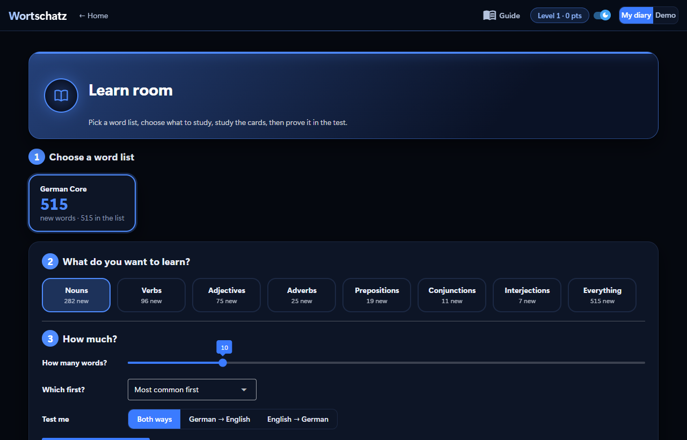
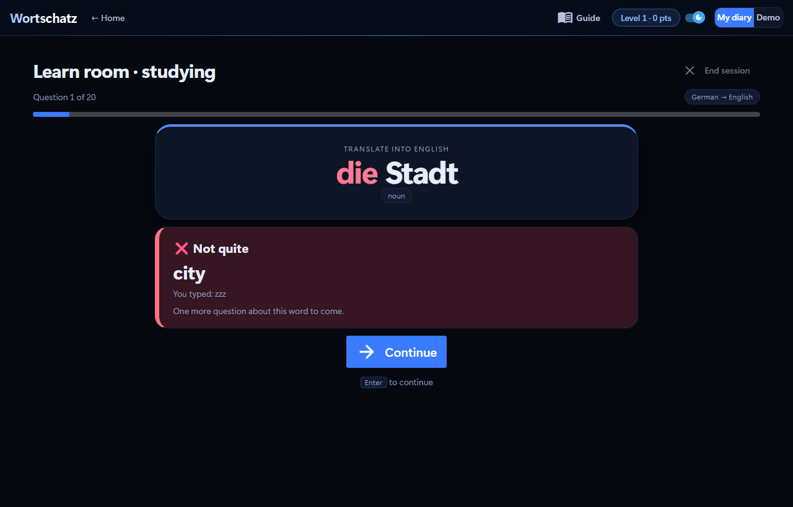
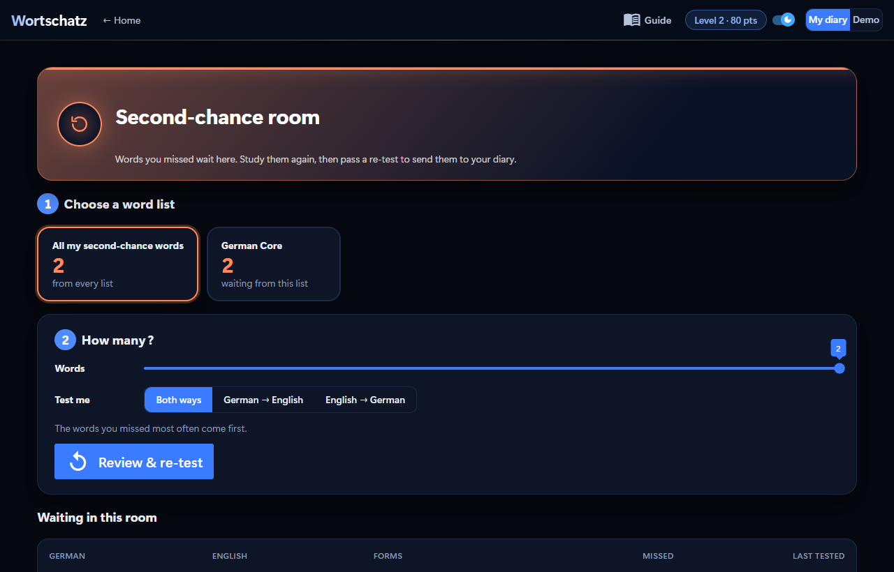
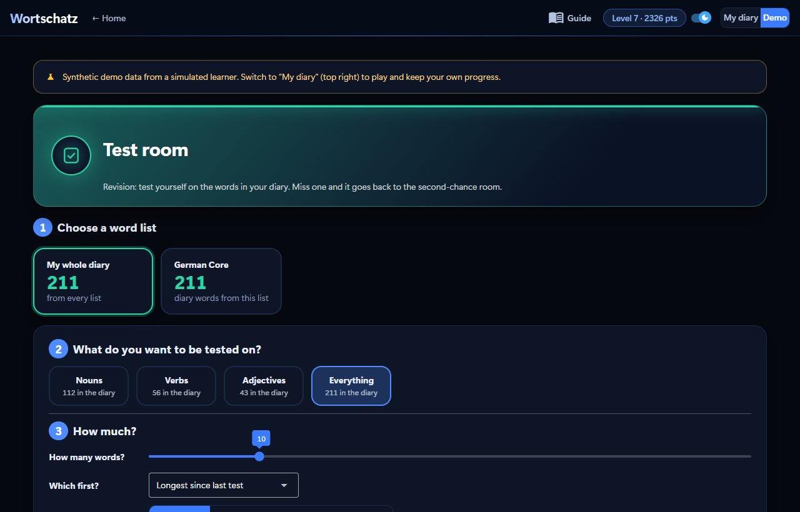
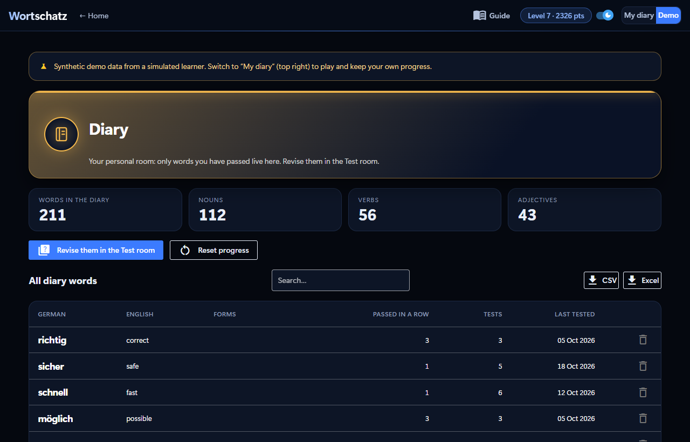
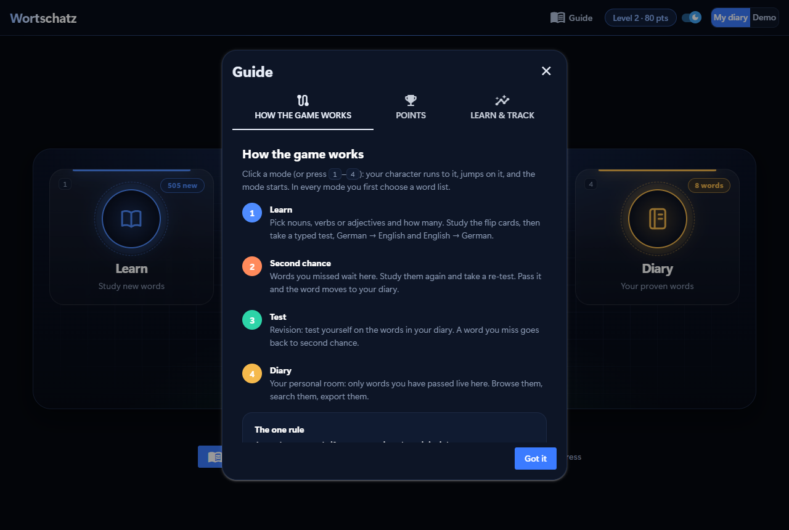
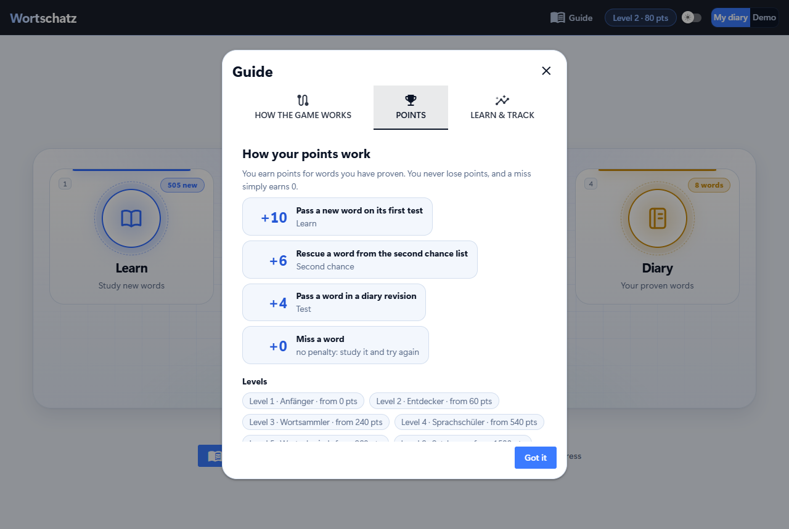
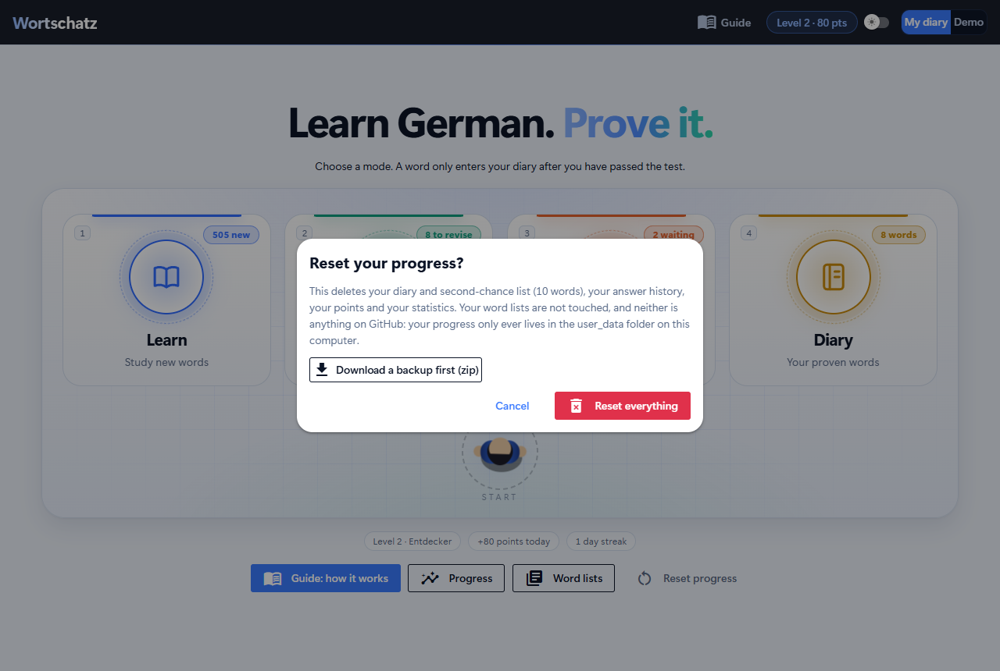
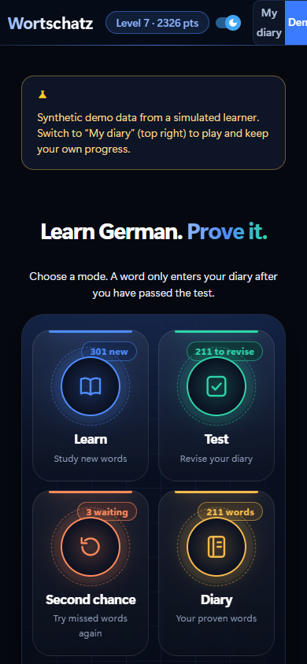

<div align="center">

# Wortschatz

**Learn German words, pass the test, build your diary.**

A local vocabulary game with one rule: *a word only enters your diary after you have proven you know it.*
Load your own Excel or CSV word list, learn with flip cards, answer by typing, and watch the statistics of your own learning.

<br>


<br>


</div>

## What makes it different

- **The diary is earned.** A word only goes into your diary after you pass *every* question about it. Miss it and it waits in the *second chance* list until you pass a re-test. A word you miss while revising falls back to second chance, so the diary only holds words you currently know.
- **Four modes, one click each.** Learn, Test, Second chance, Diary. Click a button (or press 1 to 4) and a small top-view character **runs to it and jumps on it**; then the mode starts.
- **Typed answers, both directions.** German → English and English → German. Nouns need their article, verbs need infinitive, Präteritum and Perfekt.
- **Your own words.** Drop in an Excel or CSV file of any size; the game cleans it and tells you what it changed.
- **A data-analytics project inside a game.** Every answer is logged, and the Progress page answers real questions about your learning with pandas, confidence intervals and plain-language findings.
- **Private by design.** It runs only on your computer. Your diary is saved as plain CSV in `user_data/`, which git ignores, so nothing of it ever reaches GitHub.

<div align="center">


*Click a mode: the character runs to its button, jumps on it, and the mode starts.*

</div>

## Screenshots

<table>
<tr>
<td width="50%"><br><sub><b>Opening page, dark</b> (the default)</sub></td>
<td width="50%"><br><sub><b>Opening page, light</b> (switch in the top bar)</sub></td>
</tr>
<tr>
<td><br><sub><b>Learn:</b> choose a word list, a word type and how many words</sub></td>
<td><br><sub><b>Flip cards:</b> click a card to see the other side</sub></td>
</tr>
<tr>
<td><br><sub><b>Typed test</b> in both directions</sub></td>
<td><br><sub><b>Feedback</b> after every answer</sub></td>
</tr>
<tr>
<td><br><sub><b>Results:</b> points, level-ups, and where each word went</sub></td>
<td><br><sub><b>Second chance:</b> missed words wait here for a re-test</sub></td>
</tr>
<tr>
<td><br><sub><b>Test:</b> revise the words in your diary</sub></td>
<td><br><sub><b>Diary:</b> every proven word, searchable, exportable</sub></td>
</tr>
<tr>
<td><br><sub><b>Progress:</b> statistics computed from your answer log</sub></td>
<td><br><sub><b>Word lists:</b> the columns your own file needs</sub></td>
</tr>
<tr>
<td><br><sub><b>Guide:</b> opens from a button, how the game works</sub></td>
<td><br><sub><b>Guide, points tab</b> (light theme)</sub></td>
</tr>
<tr>
<td><br><sub><b>Reset progress:</b> confirmation with a backup option</sub></td>
<td align="center"><br><sub><b>Phone width</b></sub></td>
</tr>
</table>

## How the game works

```
                  pass the test                       revise the diary any time
 new word  ─────────────────────────►  MY DIARY  ◄─────────────────────────────┐
     │                                   │  ▲                                    │
     │ miss a word                       │  │ pass the re-test                   │
     ▼                                   │  │                                    │
 SECOND-CHANCE LIST  ◄───────────────────┘  │                                    │
     └──── study it again, take a re-test ──┘      a word you miss in a revision test goes back
```

| Mode | What you do there |
|---|---|
| **Learn** | Choose a word list, a word type (nouns, verbs, adjectives, ...) and how many. Study the flip cards, then take the typed test. Passed words go into the diary. |
| **Test** | Revision: test yourself on the words in your diary. A word you miss goes back to second chance. |
| **Second chance** | Words you missed wait here. Study them again and pass a re-test to send them to the diary. |
| **Diary** | Your personal room: every word you have proven, with a search box and CSV / Excel export. |

1. **Learn.** Nouns show their article and plural; verbs show the infinitive with Präteritum and Perfekt. Cards can start with German or English.
2. **Test.** Every word is asked both ways and you *type* the answer. A word passes only when **every** question about it is right.
3. **Sort.** Passed → diary. Missed → second chance.
4. **Second chance.** Study again, take a re-test. Pass it and the word moves into the diary.
5. **Revise.** Test yourself on diary words whenever you like.

In every mode you first **choose the word list**, so you can work through one list at a time.

Every move is saved the moment a word is finished, so closing the window never loses progress.

### Points and levels

Points reward proof, not effort: **+10** for passing a new word on its first test, **+6** for rescuing a word from second chance, **+4** for passing a diary revision, and **0** for a miss (never a penalty).
Points are computed from the answer log, so they always match what really happened. Levels get further apart as you go: *Anfänger*, *Entdecker*, *Wortsammler*, *Sprachschüler*, *Wortschmied*, *Satzbauer*, *Redner*, *Kenner*, *Meister*, *Wortzauberer*.
The **Guide** button explains all of this inside the app.

### Keyboard

`1`–`4` pick a mode · `Space` flips a card · `←` `→` move between cards · `Enter` checks an answer and continues · type `ae oe ue ss` for `ä ö ü ß`, or use the letter buttons.

## Quick start

You need **Python 3.11 or newer**.

```bash
git clone https://github.com/jkevinthomas4321/My_German_Vocab_Game.git
cd My_German_Vocab_Game
pip install -r requirements.txt
python main.py
```

A browser tab opens at `http://localhost:8080` (if another program uses that port, the game picks the next free one and prints the address).
On Windows you can also double-click `run.bat`; on macOS and Linux run `./run.sh`.

Click **Demo** (top right) to explore the Progress page straight away: it shows a month of play by a *simulated* learner, separate from your own diary.

## Your own words

Open **Word lists** (a button under the main buttons). The page shows the **columns your file needs** with a *Copy header* button, and templates to download.
Drop in a `.csv` or `.xlsx` file with any number of rows (1,000 is fine); the game cleans it, shows what it changed, and lets you save it as a list to learn from.


The header row to use:

```
word_class,english,article,german,plural,past_tense,perfect_tense,zipf
```

| Column | Required | What it holds | Example |
|---|---|---|---|
| `english` | **yes** | The English meaning. Several accepted answers can be separated by `/` or `;` | `to read / to study` |
| `german` | **yes** | The German word, without its article (an article typed in the cell is split off automatically) | `lesen` |
| `word_class` | no | noun, verb, adjective, adverb, preposition, conjunction, interjection or other (default *other*) | `verb` |
| `article` | no | der, die or das. Nouns are tested with their article | `der` |
| `plural` | no | The plural, shown on noun cards | `Äpfel` |
| `past_tense` | no | Präteritum. Verbs with both tenses are tested on all three forms | `las` |
| `perfect_tense` | no | Perfekt, with its helper verb | `hat gelesen` |
| `zipf` | no | Word frequency (about 1 to 8). If present, common words are offered first | `5.2` |

Header spellings such as *Englisch*, *Deutsch*, *Artikel* and *Wortart* work too, header names are not case-sensitive, and semicolon-separated CSVs from German Excel are fine.
Save CSV files as UTF-8 so `ä ö ü ß` survive.

## Your progress, and starting over

Your diary, second-chance list and answer history live in `user_data/` on your computer as plain CSV (open them in Excel if you like).
That folder is **ignored by git**: someone who downloads this project always starts with an empty diary, and nothing you do ever reaches GitHub.

**Reset progress** (on the opening page and in the Diary) wipes your diary, second-chance list, answer history and points after a confirmation that offers a zip backup first.
Your word lists are not touched. The demo profile is read-only.


## How answers are checked

- **English:** case, spacing, a leading *to / the / a* and bracketed hints are ignored, and any translation listed in the sheet is accepted.
- **German:** must be spelled exactly, nouns with their article. Typing `ae oe ue ss` for `ä ö ü ß` is accepted.
- A blank answer, a dash, or **I don't know** is wrong. A near miss shows "Almost", but is not credited.

## The Progress page (the analytics part)

Everything on it is computed from one log of your answers (`attempts.csv`) with **pandas**, so the numbers can never disagree with what happened.
Rates carry a **95% Wilson confidence interval** and their sample size, because 100% over three tests is not the same evidence as over three hundred.

| Question | Answered by |
|---|---|
| How fast does my diary grow? | Daily diary size (+1 on entering, −1 when a word falls back or is removed) |
| Do I pass new words first time? | First-test pass rate, by word type and by direction |
| Which direction is harder? | German → English vs English → German accuracy and median answer time |
| Do second chances work? | Re-tests needed by words that failed their first test |
| Do I forget diary words? | Revision pass rate by days since the word was last tested |
| What are my hardest words? | Words that failed most often |
| When do I practise? | Calendar heat map, daily tests, streaks |

The page also writes plain-language findings, and each one stays silent when its sample is too small to say anything.

## Under the hood

```
main.py                 start the app (NiceGUI)
webapp/                 the interface: opening page, flip cards, charts, light and dark theme
  static/hero.js          the character that runs to a button and jumps on it (canvas, no libraries)
wortschatz/             the game, with no UI code
  progress.py             THE RULES: where a word lives, in 6 transitions
  session.py              choosing words, study cards, the test engine
  answers.py              checking typed answers
  storage.py              progress.csv and attempts.csv (atomic writes), backup and reset
  stats.py                the statistics
  points.py               points and levels, derived from the answer log
  wordlist.py             reading, cleaning and validating CSV / Excel sheets
  demo.py                 the simulated learner behind the Demo profile
data/wordlists/         the bundled word list
tools/                  how the bundled list is built and checked
tests/                  195 tests
```

- **The rules live in one small module** ([`wortschatz/progress.py`](wortschatz/progress.py)) and are tested exhaustively: all six transitions, the counters, and an invariant that *the saved diary equals what replaying the answer log under the rules produces*.
- **The game has no UI code**, so it is tested without a browser; the interface only calls it.
- **NiceGUI** (a Python framework on Quasar/Vue) was chosen over Streamlit for real control over the design: 3D flip cards, keyboard-driven tests, a canvas character, and a light/dark theme.
- **Plain CSV storage** with atomic writes (temporary file, then rename), so a crash cannot corrupt your diary.
- **Accessible fallbacks:** the mode buttons work without the animation script, the animation is skipped when the system asks for reduced motion, and every button is reachable by keyboard.

### The bundled word list

`data/wordlists/german_core.csv`: **515 common words** (282 nouns with article and plural, 96 verbs with Präteritum and Perfekt, 75 adjectives, plus adverbs, prepositions, conjunctions and interjections), sorted by measured frequency.
The translations, articles, plurals and verb forms were written by hand (with Claude Code) in [`tools/seed_words.csv`](tools/seed_words.csv) and are checked by automated rules, which cannot prove a translation is *right*, so a quick look against your textbook is worthwhile.
Frequency comes from the [`wordfreq`](https://github.com/rspeer/wordfreq) package (data licensed CC BY-SA 4.0; keep that attribution if you redistribute the CSV).
To rebuild it: `pip install -r requirements-dev.txt && python tools/build_wordlist.py`.

## Tests

```bash
pip install -r requirements-dev.txt
python -m pytest
```

195 tests (about three minutes): the rules and every transition, answer checking, word selection, the test engine, saving, reloading and resetting, CSV/Excel cleaning,
every statistic against hand-computed numbers (and on empty data), the demo simulator, and **end-to-end tests where a simulated browser plays the real app**
(click a mode button, learn, miss a word, pass the re-test, fail a revision, earn points and a level, quit half way, switch word lists, reset, verbs with three form boxes).
Tests use a temporary data folder and never touch your diary.

## Limitations

- A single-user, local app: no login and no hosting (your diary lives in files on your computer).
- Only `.xlsx` is supported for Excel (not legacy `.xls`).
- No audio and no example sentences.
- The demo data is simulated: it demonstrates the statistics and is not evidence about real learners.

## Earlier version

The first version of this project (a Streamlit app) is kept on the [`game_v1`](https://github.com/jkevinthomas4321/My_German_Vocab_Game/tree/game_v1) branch.

## Credits

Built with Python, pandas, NumPy and [NiceGUI](https://nicegui.io). Designed and implemented with [Claude Code](https://claude.com/claude-code).
